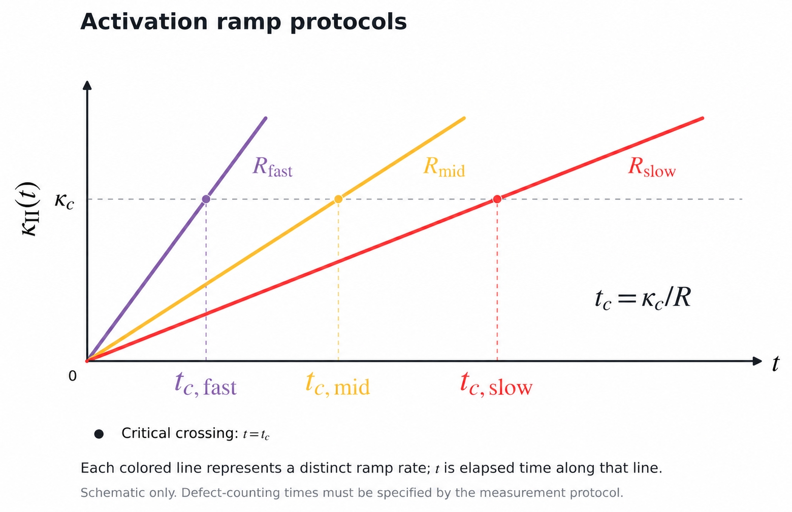
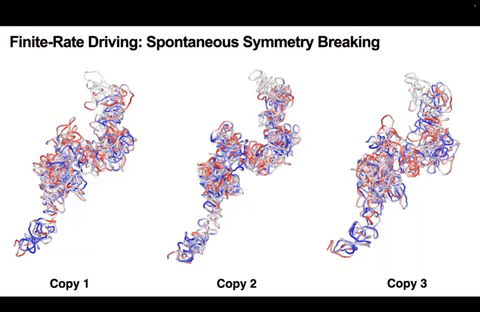

# KZM Perversion

CUDA simulator for *Dynamics of Symmetry Breaking and Defect Generation in a Single Ideal Motorized Chromosome as It Undergoes Mitosis*.

## ✨ Features

- Simulates finite-rate activation of condensin I and II in an $N$-bead chromosome starting from an interphase conformation.
- Tracks the folding dynamics in which left- and right-handed helical domains emerge and meet at boundaries called perversions.
- Saves LAMMPS-style trajectories and records motor activity along the chromosome.

## 📦 Dependencies

- Linux and GNU Make
- NVIDIA CUDA Toolkit with `nvcc` and cuRAND
- CUDA-compatible host compiler with C++17 support
- NVIDIA GPU and a compatible driver for execution

The build was verified with CUDA 12.2 and GCC 7.3.1.

## 🚀 Usage

### Build

Clone the repository and build the [CUDA simulator](simulation/activation_ramp/).

```bash
git clone git@github.com:CaOaC/KZM_Perversion.git
cd KZM_Perversion/simulation/activation_ramp
mkdir -p Input Output
make
```

The build produces `kickModel` in the current directory. The [Makefile](simulation/activation_ramp/Makefile) targets `sm_80` by default. Set `ARCH_SM` to the compute capability of your GPU without the decimal point. Run `make clean` before rebuilding for a different GPU architecture.

### Input

Supply the $N$-bead starting conformation as `Input/Interphase.txt`, with one row per bead in polymer contour order.

### Run

Run from the directory containing `kickModel` and `Input/Interphase.txt`.

```bash
./kickModel
```

- Change the bead counts and other simulation defaults in [`var.cu`](simulation/activation_ramp/var.cu).
- Change the condensin activation schedule in [`main.cu`](simulation/activation_ramp/main.cu).

Rebuild with `make` after editing the source.

### Output

| File in `Output/` | Contents |
| --- | --- |
| `trajectory_tau*_v*_ems*.dump` | LAMMPS-style trajectory with simulation timestamps, box bounds, bead IDs and types, Cartesian coordinates, condensin-I and condensin-II kick counts, and periodic image flags. The `tau` and `v` filename fields store the values of `p10` and `p_slide`. |
| `kappavstime_<ensemble>.txt` | Activity log. Each row starts with the kick-cycle count, followed by a condensin-I and condensin-II activity pair for each of the ten contour segments. |

## 📺 Demo

### Activation ramp protocols

<p align="center">
  
</p>

The schematic shows three linear ramps of condensin-II activity, $\kappa_{\mathrm{II}}(t) = Rt$. Faster ramps reach the critical activity $\kappa_c$ sooner, at $t_c = \kappa_c/R$.

### Dynamics trajectory

<p align="center">
  
</p>

Three simulated chromosome copies develop domains of opposite handedness during finite-rate activation. Red and blue indicate the two local handedness states. [Download the original MP4](assets/dynamics-trajectory.mp4?raw=true).

## 🧾 Information

Using a motorized polymer model of mitotic chromosome folding, the study shows how the rate of condensin activation governs the formation of perversions, the boundaries between left- and right-handed helical domains. The mean number of perversions formed during early ordering follows a Kibble–Zurek power law for slow activation and approaches a plateau for rapid activation. Higher motor activity slows perversion motion and turnover, allowing the defects to persist. Perversion sites are also associated with weaker helical order, layer misalignment, and local knotting.

### Citation

Zhiyu Cao, Chaoqun Du, Zhonghuai Hou, and Peter G. Wolynes. “Dynamics of Symmetry Breaking and Defect Generation in a Single Ideal Motorized Chromosome as It Undergoes Mitosis.” Manuscript, 14 November 2026.
